# RAG闭环实施

## 1. 文档目的

本文档用于指导当前 RAG 项目从“能够完成问答”升级为“可追踪、可评测、可发布、可回滚、可持续改进”的生产闭环。

当前项目已经具备以下主链路：

```text
文件上传 → 文档解析 → 文档分块 → 向量化 → 向量检索 → 可选重排 → LLM 生成 → 返回引用
```

目标是补齐以下回流链路：

```text
线上问题 / 用户反馈 / 文档变化
→ 问题分类
→ 修复知识、检索、模型或 Prompt
→ 更新测试集
→ 自动评测
→ 灰度发布
→ 线上监控验证
→ 正式发布或回滚
```

## 2. 建设原则

1. 保留当前 FastAPI、Streamlit、LangChain 的业务基础，分阶段替换不适合生产的本地内存和本地文件方案。
2. 业务数据、原始文件、向量索引、链路追踪和评测结果分别由适合的组件负责。
3. 所有文档、索引、Prompt、模型和评测结果都要有版本。
4. 任何检索或生成优化都必须先经过测试集评测，再进入灰度发布。
5. 用户反馈、低置信度问题、人工转办问题和线上异常都要能够回流到测试集。
6. 涉及权限的数据必须在检索前过滤，不能只在答案生成后补救。

## 3. 目标闭环

```mermaid
flowchart LR
    subgraph OFFLINE["离线：知识生产与发布闭环"]
        S["业务数据源"] --> C["采集与上传"]
        C --> V["安全校验 / 去重 / 权限校验"]
        V --> P["解析 / OCR / 清洗"]
        P --> K["分块 / 元数据 / 版本管理"]
        K --> E["Embedding 向量化"]
        E --> I["建索引 / 维度与版本校验"]
        I --> R["审核 / 发布 / 灰度 / 回滚"]
        R --> KB["线上可用知识库"]
    end

    subgraph ONLINE["在线：问答服务闭环"]
        U["用户提问"] --> A["认证 / 租户隔离 / 权限过滤"]
        A --> Q["问题改写 / 意图识别"]
        Q --> T["混合检索（关键词 + 向量）"]
        T --> RR["重排 / 去重 / 阈值过滤"]
        RR --> D{"召回证据是否足够？"}
        D -- "否" --> N["追问澄清 / 拒答 / 转人工"]
        D -- "是" --> G["受约束生成（带引用生成）"]
        G --> X["引用校验 / 事实校验 / 安全合规校验"]
        X --> O["输出答案 + 来源 + 置信度"]
    end

    KB --> T
    O --> F["用户反馈：点赞踩 / 纠错 / 追问 / 人工采纳"]
    N --> F
    F --> DS["标注数据与评测集"]
    DS --> EV["离线评测 / 线上质量指标 / 回归测试"]
    EV --> OPT["调优：分块策略 / Embedding / 检索重排 / Prompt"]
    OPT --> RE["重建索引 / 灰度发布 / 回滚"]
    RE --> R
    O -. "日志 / 延迟 / Token / 成本 / 错误 / 告警" .-> OBS["可观测性平台"]
    OBS --> EV
```



说明：可观测性指标用于发现服务和质量异常，但不能代替人工标注或标准答案。答案质量仍需要测试集和评测结果确认。

## 4. 多个闭环的职责

### 4.1 知识更新闭环

```text
数据源新增或修改
→ 内容 Hash 检测
→ 生成新文档版本
→ 解析、分块、向量化
→ 构建新索引
→ 通过校验后发布
→ 旧版本失效或保留用于回滚
```

必须记录文档 ID、内容 Hash、版本号、来源、责任人、生效时间、失效时间和权限范围。

### 4.2 在线问答闭环

```text
用户提问
→ 身份认证和权限过滤
→ 查询改写
→ 关键词 + 向量混合召回
→ 重排和阈值判断
→ 证据足够则生成答案
→ 引用、事实和安全校验
→ 返回答案、来源和置信度
```

证据不足时需要明确拒答、追问或转人工，不能只依赖 Prompt 自己判断。

### 4.3 用户反馈闭环

反馈至少包括：点赞、点踩、错误类型、文字纠错、是否解决问题、转人工结果。

反馈需要被归类为：

- 知识缺失或文档过期。
- 文档切分不合理。
- 检索没有召回正确内容。
- 重排顺序错误。
- LLM 理解或生成错误。
- 权限过滤错误。
- 系统超时或服务失败。

不同类型的问题由不同模块负责修复，不能所有问题都通过更换大模型解决。

### 4.4 测试集和评测闭环

测试集至少分为以下几类：

| 测试集 | 主要目的 | 典型指标 |
|---|---|---|
| 检索测试集 | 判断是否召回正确片段 | Recall@K、MRR、NDCG |
| 答案测试集 | 判断答案是否正确、完整 | 正确性、完整性、相关性 |
| 引用测试集 | 判断引用是否支持答案 | 引用支持率、引用完整率 |
| 拒答测试集 | 判断无依据时是否拒答 | 拒答准确率、越权回答率 |
| 安全测试集 | 检查注入、敏感信息和越权 | 攻击拦截率、敏感信息泄露率 |
| 回归测试集 | 防止历史问题再次出现 | 通过率、退化项数量 |

单条评测数据至少包含：问题、历史会话、期望文档 ID、参考答案、要求引用、权限范围和标签。

### 4.5 发布和回滚闭环

```text
修改模型、分块、检索或 Prompt
→ 生成候选版本
→ 执行评测
→ 质量达到门槛
→ 灰度流量
→ 观察线上指标
→ 正式发布或回滚
```

索引不能直接覆盖生产索引，应使用新版本索引，验证通过后通过别名或路由切换。

### 4.6 监控和运营闭环

需要同时监控系统指标和答案质量：

- 系统指标：请求量、错误率、超时率、P95/P99 延迟。
- 检索指标：召回数量、相关性分数、无结果比例。
- 生成指标：Token、成本、模型耗时、拒答率。
- 质量指标：点踩率、引用支持率、人工转办率、低置信度比例。
- 数据指标：入库成功率、解析失败率、索引版本和文档数量。

## 5. 技术选型

### 5.1 保留的现有技术

| 技术 | 继续使用的原因 |
|---|---|
| FastAPI | 当前后端接口基础已经具备 |
| Streamlit | 当前管理和问答页面基础已经具备 |
| LangChain | 当前 RAG 编排已经基于 LangChain |
| Python | 现有工程和模型生态均基于 Python |

### 5.2 新增技术及理由

| 技术 | 负责内容 | 选择理由 |
|---|---|---|
| PostgreSQL | 文档、版本、任务、权限、反馈、测试集、评测结果 | 支持事务、查询、审计和结构化数据持久化 |
| MinIO 或 S3 | 原始文件和索引快照 | 支持对象存储、版本和备份恢复 |
| Redis + Celery | 入库、重建索引、评测等异步任务 | 支持队列、重试和失败任务处理，改造成本较低 |
| Qdrant | 向量检索 | 支持向量检索、元数据过滤和索引管理 |
| OpenSearch | 关键词和混合检索 | 支持 BM25、全文检索和向量融合 |
| Langfuse | LLM 调用链、Prompt、反馈、Token、成本 | 可自部署，适合私有化场景 |
| Ragas | RAG 离线质量评测 | 提供上下文质量、答案相关性和忠实度指标 |
| pytest | 回归测试和发布门禁 | 方便接入 CI/CD，阻止质量退化版本发布 |
| OpenTelemetry | 标准化跨服务链路追踪 | 避免只能依赖单一监控平台 |
| Prometheus + Grafana | 指标、图表和告警 | 适合服务运行状态和资源监控 |

### 5.3 框架之间的边界

没有一个框架可以同时可靠地完成文件存储、权限、任务队列、向量索引、反馈、评测、监控和发布。

建议按职责组合：

```text
LangChain：RAG 流程编排
Langfuse：LLM 调用链和反馈追踪
Ragas：答案和检索质量评测
OpenTelemetry：标准调用链
Celery：异步任务和重试
PostgreSQL：业务数据事实来源
```

如果接受云服务，可以用 LangSmith 替代 Langfuse；如果要求完整私有化，优先使用自部署 Langfuse。

## 6. 核心数据对象

### 6.1 文档和版本

- `document_id`
- `source_uri`
- `original_filename`
- `content_hash`
- `version`
- `status`：待处理、处理中、已发布、已下线、失败
- `category`
- `owner`
- `permission_scope`
- `effective_at`
- `expired_at`
- `created_at`、`updated_at`

### 6.2 入库任务

- `job_id`
- `document_id`
- `job_type`
- `status`
- `retry_count`
- `error_message`
- `started_at`、`finished_at`

### 6.3 索引版本

- `index_version`
- `embedding_model`
- `embedding_dimension`
- `chunking_strategy`
- `chunking_params`
- `vector_store`
- `document_count`
- `status`
- `created_at`

### 6.4 反馈和评测

- 反馈：问题、答案、引用、用户、评分、问题类型、人工结论。
- 测试集：问题、期望文档、参考答案、引用要求、权限和标签。
- 评测运行：代码版本、模型版本、索引版本、指标结果、是否通过。

## 7. 分阶段实施

### 阶段一：基础数据和任务可靠性

- 建立 PostgreSQL 数据模型。
- 增加文档 ID、Hash、版本和状态。
- 将入库任务从内存状态改为持久化任务。
- 增加任务查询、重试和失败原因。
- 保留现有 Chroma，先完成业务闭环。

### 阶段二：反馈和测试集

- 增加点赞、点踩、纠错和转人工接口。
- 增加反馈分类。
- 建立检索、答案、引用、拒答和安全测试集。
- 将反馈中的高价值问题加入回归测试集。

### 阶段三：自动评测和质量门禁

- 接入 Langfuse 记录问答链路。
- 接入 Ragas 执行离线评测。
- 使用 pytest 判断是否通过质量门槛。
- 记录每次模型、Prompt、索引和配置版本。

### 阶段四：检索和回答质量增强

- 引入关键词 + 向量混合检索。
- 召回 Top 20，再重排 Top 5。
- 增加去重、阈值过滤和证据不足判断。
- 增加引用校验、事实校验和安全检查。
- 增加基于用户权限的检索过滤。

### 阶段五：发布、监控和回滚

- 建立索引版本和快照。
- 新旧索引并行构建。
- 灰度发布和别名切换。
- 接入 OpenTelemetry、Prometheus 和 Grafana。
- 建立错误、延迟、成本和质量告警。
- 支持一键回滚到上一版本。

## 8. 发布门槛建议

初期可先设置相对保守的门槛，后续根据真实数据调整：

- 检索 Recall@K 不低于当前生产基线。
- 答案正确性不低于当前生产基线。
- 引用支持率不低于当前生产基线。
- 拒答测试集不得出现明显越权回答。
- 高风险安全测试集必须全部通过。
- P95 延迟和 Token 成本不能超过预算。
- 新版本不能造成历史回归集明显退化。

具体阈值应以真实业务测试集建立基线后确定，不能直接凭经验设定。

## 9. 风险和控制措施

| 风险 | 控制方式 |
|---|---|
| 组件过多、部署复杂 | 分阶段接入，先 PostgreSQL、反馈和评测，再升级检索基础设施 |
| 索引重建时间长 | 新旧索引并行构建，完成后切换别名 |
| 模型调用成本上升 | 记录 Token 和成本，设置预算和限流 |
| 评测指标与真实体验不一致 | 同时使用自动评测、用户反馈和人工抽检 |
| 权限过滤错误 | 在检索前过滤，并增加越权测试集 |
| 旧数据迁移失败 | 先备份，保留旧索引和回滚路径 |
| 敏感数据泄露 | 密钥使用环境变量或密钥管理服务，原始文件和追踪平台进行访问控制 |

## 10. 最终验收标准

- 文档可以新增、修改、下线、恢复，并能追踪版本。
- 入库失败可以查询原因并自动重试。
- 用户反馈可以保存、分类并进入测试集。
- 每个问答请求可以查看完整调用链和耗时。
- 每次模型、Prompt 或索引变更都能自动评测。
- 评测不通过的版本不能发布。
- 线上出现异常时可以定位并回滚。
- 用户只能检索自己有权限访问的知识。
- 线上问题可以回流到测试集，形成持续改进闭环。

## 11. 第一阶段已落地内容

本阶段已在当前项目中接入以下能力：

- SQLAlchemy 业务数据层：本地默认使用 `rag_qa.db`，生产环境通过 `DATABASE_URL` 使用 PostgreSQL。
- 问答记录：每次问答生成 `interaction_id` 和 `trace_id`，保存问题、答案、来源、模型、Embedding 和耗时。
- Langfuse 适配：开启并配置密钥后，记录问答 Trace；未配置时自动降级，不阻断问答。
- 用户反馈：`POST /api/v1/qa/feedback`，支持正向/负向反馈、分类和文字说明。
- 测试集接口：`POST/GET /api/v1/evaluation/cases`。
- 评测运行记录：`POST/GET /api/v1/evaluation/runs`，可查看单次运行详情。
- Ragas 离线评测入口：`python scripts/run_ragas_eval.py`。
- 第一阶段数据测试：`pytest tests/test_phase1_data.py -q`。
- RAG评测中心页面：管理测试题、启动后台评测、查看运行状态和逐题结果。

### 11.1 配置示例

本地开发可以不增加配置，默认使用 SQLite 且不向 Langfuse 上传内容。生产环境建议在环境变量或密钥管理服务中配置：

```env
DATABASE_URL=postgresql+psycopg://用户名:密码@数据库地址:5432/rag
LANGFUSE_ENABLED=true
LANGFUSE_PUBLIC_KEY=你的公钥
LANGFUSE_SECRET_KEY=你的私钥
LANGFUSE_HOST=https://你的Langfuse地址
LANGFUSE_CAPTURE_CONTENT=false
```

`LANGFUSE_CAPTURE_CONTENT=false` 时只记录长度等元数据，适合先验证链路；确认数据脱敏和访问控制后，再决定是否记录问题和答案正文。

### 11.2 第一阶段使用顺序

1. 启动后端，数据库表会自动创建。
2. 调用 `/api/v1/qa/ask`，响应中取得 `interaction_id`。
3. 调用 `/api/v1/qa/feedback` 保存用户反馈。
4. 调用 `/api/v1/evaluation/cases` 添加带参考答案的测试题。
5. 执行 `python scripts/run_ragas_eval.py` 运行离线评测。
6. 通过 `/api/v1/evaluation/runs/{run_id}` 查看指标和逐题结果。

也可以直接进入 Streamlit 的“RAG评测中心”页面完成以上操作。页面启动评测后，后端返回 `pending`，再由后台任务更新为 `running`、`completed` 或 `failed`，页面通过刷新查看最新状态。

Ragas 评测需要可用的当前 LLM 和 Embedding；页面和离线脚本使用同一套冻结测试集评测逻辑，不会增加普通问答的评分开销。后续第1–5批已补齐检索权限、发布门禁、持久化任务、候选索引和灰度回退；当前交付和验收边界见 [批次1-5交付与验收](批次1-5交付与验收.md)。
